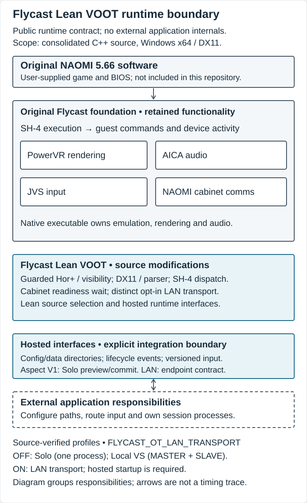
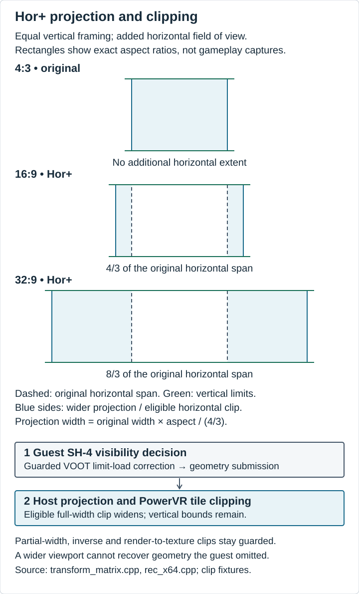
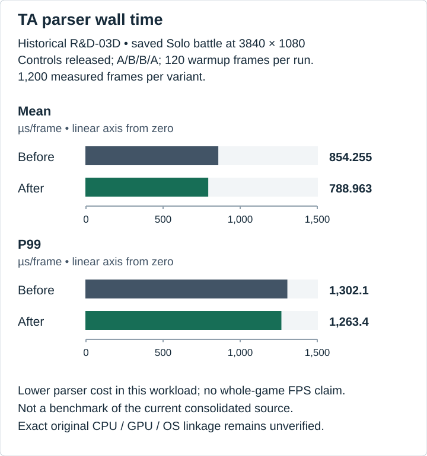

# Flycast Lean VOOT

### A dedicated Flycast runtime for Virtual-On: Oratorio Tangram M.S.B.S. Ver. 5.66

**Preserving the original NAOMI arcade experience while bringing its presentation and performance forward on modern PC hardware.**

## About the Project

*Virtual-On: Oratorio Tangram* remains one of SEGA's most distinctive arcade experiences. Its fast-paced combat, precise Twin-Stick controls, and linked cabinet battles helped define what made the original game special.

Despite several console releases, preserving the original NAOMI 5.66 experience on modern hardware presents its own challenges, particularly when it comes to display compatibility, performance, and linked multiplayer.

Flycast already provides a strong foundation for running the original arcade software. Rather than recreating the game or developing another emulator from scratch, this project builds upon that foundation with targeted improvements focused on *Oratorio Tangram*.

The initial goal was straightforward: establish a reliable, lightweight runtime that preserves the original game while removing unnecessary overhead.

As development progressed, the work expanded into areas that required deeper investigation of the original NAOMI hardware behavior and Flycast's execution pipeline.

## Beyond a Lightweight Runtime

Flycast Lean VOOT is more than a stripped-down emulator build.

The project introduces source-level improvements to Flycast's existing architecture, focusing on areas where the original game's assumptions and modern PC hardware don't always align.

One of the largest efforts has been modern display support.

Simply increasing rendering resolution or stretching the original 4:3 picture isn't enough to provide proper widescreen gameplay. Achieving genuine horizontal expansion required investigating how VOOT submits geometry, how Flycast handles PowerVR clipping and projection, and how the original game determines which objects remain visible.

These investigations led to targeted corrections that allow the game world to expand horizontally while retaining the original vertical framing and preserving the underlying gameplay.

Additional work focuses on SH-4 execution efficiency, rendering performance, cabinet communications, and reliable runtime integration.

The objective isn't to change how *Oratorio Tangram* plays. It's to address the technical limitations surrounding how the original software runs and appears today.

## Development Philosophy

The original NAOMI 5.66 release remains our reference.

Gameplay mechanics, movement, weapons, timing, and arcade behavior should remain faithful to the source material. Improvements must be measurable, reproducible, and validated against that baseline.

Not every experiment becomes a permanent improvement. Some investigations expose limitations, others require a different approach, and occasionally the original behavior proves to be the better choice.

Those findings are worth preserving alongside the successful changes.

Development documentation covers the technical decisions, implementation details, measured results, and known limitations so other developers can understand the work and build upon it.

## Part of PROJECT OT

Flycast Lean VOOT began as the dedicated execution runtime for **PROJECT OT: Virtual On Experience**, a separate fan-created project focused on bringing the original arcade experience to modern Windows systems.

PROJECT OT provides the surrounding player experience, including controller management, display configuration, audio, session coordination, and multiplayer presentation.

Flycast Lean VOOT focuses on executing the original NAOMI software.

Keeping these responsibilities separate allows the runtime to remain independently maintained and documented while supporting integration with the broader PROJECT OT framework.

## Open Development and Preservation

Flycast Lean VOOT is derived from the open-source Flycast project and retains its applicable GPL licensing obligations.

The repository documents our modifications alongside the original upstream foundation, with appropriate attribution to Flycast's developers and the research that helped inform this work.

No commercial game ROMs, NAOMI BIOS files, or proprietary SEGA assets are included.

**Preserve the game. Improve the experience.**

## Technical Improvements

Getting the original game running gave us a baseline. The work that followed focused on the points where its arcade assumptions meet Flycast's rendering, execution and communication paths.

| Area | Work retained in the runtime | Details |
| --- | --- | --- |
| PowerVR and DX11 | Cached state selection, presentation queue request, stable depth sorting and palette conversion | [Rendering](docs/rendering/RENDERING.md#dx11-and-powervr) |
| Hor+ presentation | Render-target-aware projection and guarded horizontal tile clipping | [Projection and clipping](docs/rendering/RENDERING.md#hor-projection-and-clipping) |
| VOOT visibility | A narrowly matched correction for horizontal bounds in Flycast's dynamic SH-4 execution path | [Visibility investigation](docs/rendering/RENDERING.md#voot-horizontal-visibility) |
| SH-4 execution | Direct MMU-off block lookup with the existing MMU-enabled fallback | [Execution study](docs/performance/PERFORMANCE.md#sh-4-block-dispatch) |
| Cabinet communication | Windows readiness waiting and separate Solo/Local and LAN configurations | [Runtime profiles](docs/ENGINEERING.md#runtime-profiles) |

The rendering path separates guest geometry submission from host projection and clipping:

## Performance and Validation

Focused measurements helped us decide which changes were worth keeping. Their workloads, sample counts and counterexamples are recorded in the [performance notes](docs/performance/PERFORMANCE.md). Those studies measure particular host costs; the consolidated source still needs its own performance characterization.

Both Windows x64 Release profiles built from a clean source checkout. Focused rendering, host, transport and actual runtime startup/shutdown checks passed at source checkpoint `e8d678072a10`. Full physical gameplay and sustained cross-PC LAN qualification remain open for that revision. [Validation scope](docs/ENGINEERING.md#validation-scope)

The [SH-4 figure](docs/assets/performance/rd03e-dispatch.svg) includes the render-start P99 regression; the [NAOMI waiting figure](docs/assets/performance/rd04a-link-wait.svg) includes both cabinet roles. [Figure evidence and limits](docs/assets/VISUAL-EVIDENCE.md) distinguish historical measurements from current-source validation.

## Building Flycast Lean VOOT

The runtime builds as a native executable, `flycast.exe`. Our validated development configuration uses Windows x64, DX11, Lean mode and hosted startup. The [build recipe](docs/engineering/FLV-GIT01-Consolidation.md#windows-builds) records the toolchain, dependency recovery and complete CMake flags.

Use `FLYCAST_OT_LAN_TRANSPORT=OFF` for Solo/Local and `ON` for the preserved LAN transport. An external host supplies the supported runtime configuration and manages the processes. Lean mode currently excludes artwork and scraping; complete frontend exclusion remains an open qualification. [Architecture and integration](docs/ENGINEERING.md)

## Development History

The [source-history index](DEVELOPMENT_HISTORY_V1.0.md) follows the upstream foundation, retained improvements and recovery checkpoints. The full approved Development History V1.0 narrative is still pending import. Its existing verified content remains available while that original draft is recovered.

## Documentation

- [Engineering and runtime interfaces](docs/ENGINEERING.md)
- [Rendering, projection and visibility](docs/rendering/RENDERING.md)
- [Performance studies and limitations](docs/performance/PERFORMANCE.md)
- [Hardware and validation platform](docs/hardware/VALIDATION-PLATFORM.md)
- [Changelog](CHANGELOG.md)

### Maintainer review material

- [Editorial imports and review status](docs/DOCUMENTATION-STATUS.md)
- [Visual asset planning checklist](docs/assets/ASSET-CHECKLIST.md)

## Credits and Acknowledgments

Flycast Lean VOOT builds on [Flycast](https://github.com/flyinghead/flycast), maintained by flyinghead and its contributors, and Flycast's [reicast](https://github.com/skmp/reicast-emulator) foundation. Their emulation work, source history and attribution remain part of this project.

The runtime also retains its third-party dependency sources and notices. The engineering documents link our changes to the actual implementation and the records used to evaluate them.

## Licensing and Legal

Flycast-derived source retains the applicable GPL notices and the original [license text](LICENSE). Dependencies and other assets retain their own licensing requirements. The [licensing review](docs/LICENSING.md) records the remaining corresponding-source, notices, recipient-access and asset-rights checks before distribution.

## Upstream Flycast Reference

The [upstream reference page](docs/upstream/README.md) retains Flycast's original build badges, download links and platform instructions. Those belong to upstream Flycast. The Flycast Lean VOOT configuration and validation scope are documented above.
