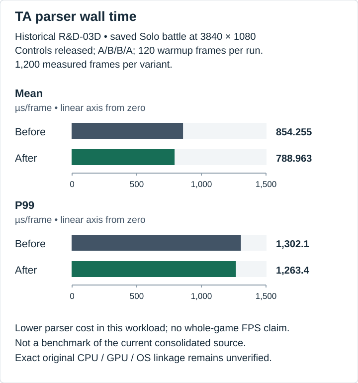
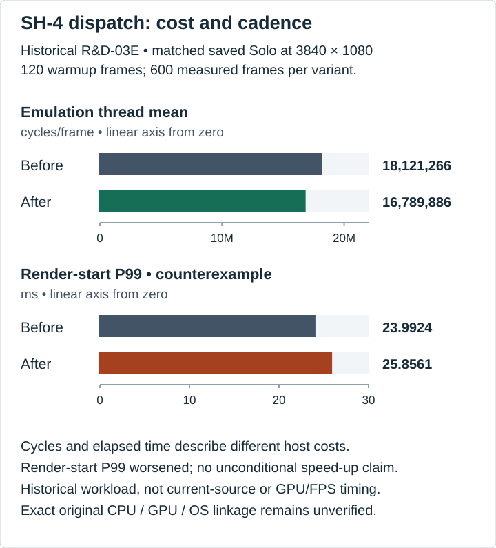
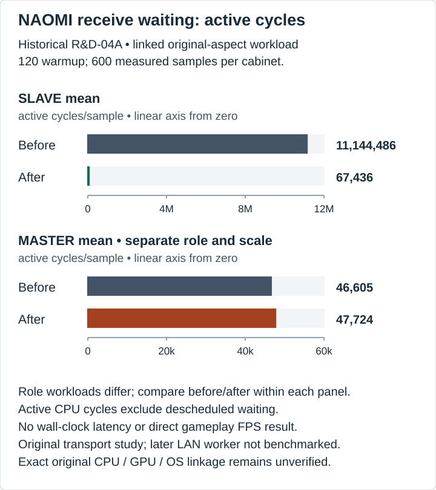

# Performance evidence

Profiling helped us choose small changes that addressed measured host costs. Each study below belongs to its retained workload and source snapshot. Consolidated `main` has source and regression validation, while its own performance characterization remains pending.

The [measurement extract](measurements.json) preserves the recorded values, workloads and SHA-256 identities for the maintainer's source records.

## Recorded results

| Study | Metric | Before | After | Measured scope |
| --- | --- | --- | --- | --- |
| R&D-03D | TA parser mean, µs/frame | 854.255 | 788.963 | Saved Solo battle, 3840×1080; 1,200 frames per variant |
| R&D-03E | Emulation mean, cycles/frame | 18,121,266 | 16,789,886 | Matched saved Solo battle, 3840×1080; 600 frames per variant |
| R&D-04A | SLAVE link mean, active cycles/sample | 11,144,486 | 67,436 | Linked original-aspect run; 600 samples per cabinet |

## Palette conversion

Texture conversion was a substantial nested part of TA parsing in the recorded scene. The selected palette bank stays fixed for a conversion, so repeating its lookup for every texel was avoidable host work. R&D-03D kept that base in the converter while retaining the existing per-texel palette reads and decoding behavior. The implementation remains present. [Palette conversion](../../core/rend/texconv.cpp#L279)

R&D-03D used A/B/B/A runs from the same saved Solo battle at 3840×1080, with controls released, 120 warmup frames per run and 1,200 measured frames per variant. Workload totals matched. Alongside the mean in the table, parser P99 changed from 1,302.100 → 1,263.400 µs. This measures parser work in that scene and does not establish a whole-game FPS or latency improvement.

## SH-4 block dispatch

Every guest block needs a compiled-code lookup. The general helper handles MMU-enabled cases, but using it for the simpler MMU-off lookup added host dispatch work. R&D-03E emitted that existing lookup directly in the x64 path, checking MMU state and retaining the MMU-enabled helper. [MMU-aware dispatch](../../core/rec-x64/rec_x64.cpp#L743)

For the primary pair, both variants used a matched saved Solo battle at 3840×1080, with 120 warmup and 600 measured frames per variant. Process cycles/frame were 25,121,222 → 24,004,624, while render-start P99 increased from 23.9924 to 25.8561 ms. That counterexample remains part of the result. Lower host cycle counts in this workload do not establish better tail cadence or increased gameplay FPS.

## NAOMI receive waiting

Waiting for link data is part of the SLAVE cabinet's normal work. Repeated nonblocking polling consumed active CPU while waiting, making readiness waiting worth testing. R&D-04A used the Windows socket readiness path within the communication-board loop's existing deadline. [Readiness source](../../core/network/naomi_network.cpp#L34)

In the linked original-aspect run, each cabinet used 120 warmup and 600 measured samples per cabinet. SLAVE active cycles fell as shown above. MASTER mean active cycles/sample were 46,605 → 47,724, with differing MASTER/SLAVE scene workloads. Active waiting cost and elapsed wait time describe different things. The later LAN worker transport has no matched benchmark in this study.

## Limits and rejected work

Thread cycles exclude descheduled waiting. Host wall time can include driver blocking, and nested conversion and parser stages must not be added together. These focused results establish neither general whole-game FPS gains nor input-to-display latency. Cycle counts are not converted into time.

Existing instrumentation records bounded host stages and thread/process counters. Exact original CPU, GPU and Windows OS build linkage remains unverified. The [platform note](../hardware/VALIDATION-PLATFORM.md) separates the known build configuration from that hardware gap. [Cycle instrumentation](../../core/rend/dx11/dx11_renderer.cpp#L67)

Some experiments did not justify a permanent change. The R&D-06A row-pointer study remains historical because its measured implementation is absent from the selected source. The R&D-06B load-result handoff, R&D-06C FPU change, R&D-06D FTRV change and R&D-06E local PAL8 unpacker were reverted or rejected. They contribute no claimed gain to consolidated `main`.

## Maintainer figure review

The [figure checklist](../assets/ASSET-CHECKLIST.md) keeps the recorded metrics, units, sample counts, workload descriptions and counterexamples together when preparing charts. The [figure evidence register](../assets/VISUAL-EVIDENCE.md#vis-05-through-vis-07-historical-performance) identifies their source records and generation method.
