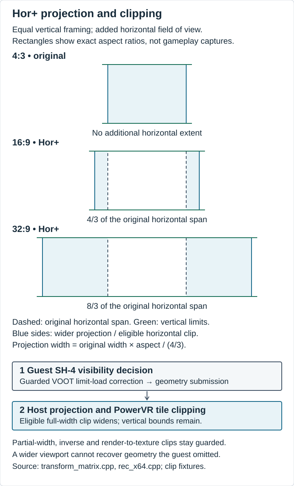
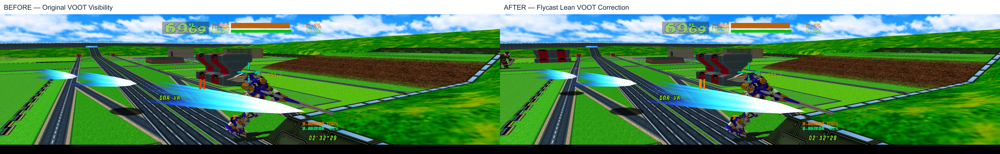

# Rendering, projection and visibility

Widescreen support started with a simple problem. A larger output surface could show more of the world, but changing that surface alone did not resolve the original game's visibility and clipping assumptions.

These notes describe source checkpoint `e8d678072a10e767f70549e967350203f007d10c`. Historical physical checks and the consolidated source's automated tests have separate scopes.

## DX11 and PowerVR

Reducing repeated host work was one part of the rendering investigation. Depth-stencil and blend caches already retain their COM state objects, so returning references avoids creating a temporary owner for each cached selection. DXGI maximum frame latency is requested as one, with the existing warning path retained if the request fails. [Depth-state cache](../../core/rend/dx11/dx11_renderstate.h#L95), [Blend-state cache](../../core/rend/dx11/dx11_renderstate.h#L187), [Queue request](../../core/rend/dx11/dx11context.cpp#L133)

Stable depth sorting uses reusable scratch storage and radix passes for eligible lists. Small lists, sensitive floating-point inputs and allocation failure retain the comparison-sort path. This keeps the original fallback where the faster path is unsuitable. [Sort helper](../../core/hw/pvr/ta_triangle_sort.h#L27)

Palette conversion offered another repeated cost. Retaining the selected lookup base per conversion avoids repeating that selection for each texel, while the converter continues to read current palette contents. [Palette converter](../../core/rend/texconv.cpp#L279)

The [retained host fixtures](../../tests/voot-host/README.txt) cover sorting, palette conversion, dispatch and socket readiness. Their equivalence checks and the historical [performance studies](../performance/PERFORMANCE.md) answer different questions.

## Hor+ projection and clipping

Keeping the original vertical framing while showing more world horizontally required the projection to follow the actual render target. `TransformMatrix::CalcMatrices` uses those dimensions for super-widescreen expansion. The established widescreen path uses its 16:9 expansion, with separate handling for rotation, framebuffer emulation and render-to-texture. [Matrix calculation](../../core/rend/transform_matrix.cpp#L88)

A wider projection could still meet a tile clip based on the original horizontal limits. `getTileClip` therefore widens an eligible full-width horizontal clip to the base scissor. Its guards retain partial-width, inverse and render-to-texture cases and the original vertical limits. [Tile-clip guards](../../core/rend/transform_matrix.cpp#L216)

Original-aspect behavior is covered by the matrix fixture family. The differential corpus compares the clipping implementation with its retained reference calculation. [Regression corpus](../../tests/src/VootWidescreenClipTest.cpp#L353)

## VOOT horizontal visibility

Three points in the geometry path needed separate investigation.

1. The original game decides whether to submit an object and emits its PowerVR commands.
2. Flycast processes submitted geometry and applies projection and clipping.
3. An object rejected by the game before submission has no geometry for the renderer to recover through clipping changes alone.

R&D-02D traced the remaining VOOT defect to that earlier visibility decision. Enlarging the renderer's viewport could not bring back objects that the game had already rejected. Matching replay evidence in R&D-02D showed geometry returning to the submitted stream once the horizontal bounds were corrected.

An extra horizontal extent is published from the eligible VOOT world viewport. Its value is zero when the source guards do not admit the correction. [Extent calculation](../../core/rend/transform_matrix.cpp#L107), [Shared extent](../../core/rend/voot_visibility.h#L8)

Inside Flycast's existing dynamic SH-4 compiler, the correction recognizes two identified bound loads. It checks the title, load width, destination register and six-instruction signature before adjusting the generated load result by that extent. The specialization is limited to the matched code. This happens as part of emulated execution; the original ROM and BIOS files and guest instruction bytes are preserved. [Guarded specialization](../../core/rec-x64/rec_x64.cpp#L262)

This R&D-02D figure summarizes the retained matched Solo replay at 3840×1080, sample 2, in the x64/DX11 diagnostic investigation. The three material groups contribute 348 + 201 + 27 polygon records. The whole sample changes from 1,687 to 2,411 polygons, including other returning geometry. These are local mesh identifiers, not formal guest object IDs. [Record identities and scope](../assets/VISUAL-EVIDENCE.md#vis-03-submission-evidence)

## VIS-01 matched gameplay comparison

FLV-DOC02-B2 rebuilt two isolated Windows x64 DX11 diagnostics from the preserved R&D-02D source. BEFORE disables only the guard for the two horizontal visibility limit-load adjustments; AFTER retains the correction. Both keep the same widescreen projection, renderer clipping, vertical framing, HUD logic and capture instrumentation. BEFORE represents the original visibility restriction in a controlled build, rather than an untouched historical executable.

The far humanoid mesh at the extreme left is missing with the original guest visibility bounds and returns with the guarded correction. Full frames are available as [BEFORE — Original VOOT Visibility](../assets/rendering/voot-visibility-before.png) and [AFTER — Flycast Lean VOOT Correction](../assets/rendering/voot-visibility-after.png). Each is an uncropped 3840×1080 lossless framebuffer capture. The side-by-side image adds a label margin; neither gameplay panel is resized or reconstructed.

These are new captures from the same preserved ver854 Solo state, with physical input disabled. All four capture-relative geometry streams per variant match the corresponding historical R&D-02D streams byte for byte, and paired projection matrices are identical. The new AFTER pixels also match the recovered R&D-03D reference. Matching uses the saved state, rendered scene and capture-relative sequence; an absolute guest simulation-frame ID was not exported, and differing global startup frame counters are not treated as the matching key.

Independent recounting of the **new** sample-2 records reproduces 0/0/0 → 348/201/27 polygons in the three far-mesh groups (576 restored records), and 1,687 → 2,411 for the whole sample. Other legitimately submitted geometry accounts for the remaining increase. These are geometry-submission measurements, not gameplay FPS or latency results. The earlier VIS-03 figure remains historical evidence.

The [VIS-01 provenance record](../assets/rendering/vis01-provenance.json) identifies source differences, compiler/SDK, executable and image hashes, and matching conditions. Private raw diagnostics, game/BIOS archives and source/build workspaces are excluded. The maintainer authorized this private draft integration; public publication and screenshot-rights approval remain separate. The comparison qualifies this reproduced scene, not all stages, camera angles or the current production runtime.

## Aspect and HUD qualification

The retained R&D-02D record reports restored submitted geometry and short physical checks at original 4:3, 16:9 and ultrawide aspects. Wider stage, character and camera-angle coverage remains pending. The consolidated revision has its own scoped [automated and startup validation](../ENGINEERING.md#validation-scope).

World expansion and HUD placement need separate review. The targeted visibility correction does not establish a complete ultrawide HUD policy or qualify every world-relative indicator, weapon and targeting behavior. Complete matches and broader aspect/HUD checks remain part of the rendering qualification work.

## Maintainer figure review

The [asset checklist](../assets/ASSET-CHECKLIST.md) plans matched captures and projection/visibility figures. The technical figures are available for maintainer review. VIS-01 now has a verified matched scene and provenance for private integration. Public screenshot-rights approval and hardware imagery remain pending. [Figure evidence](../assets/VISUAL-EVIDENCE.md)
